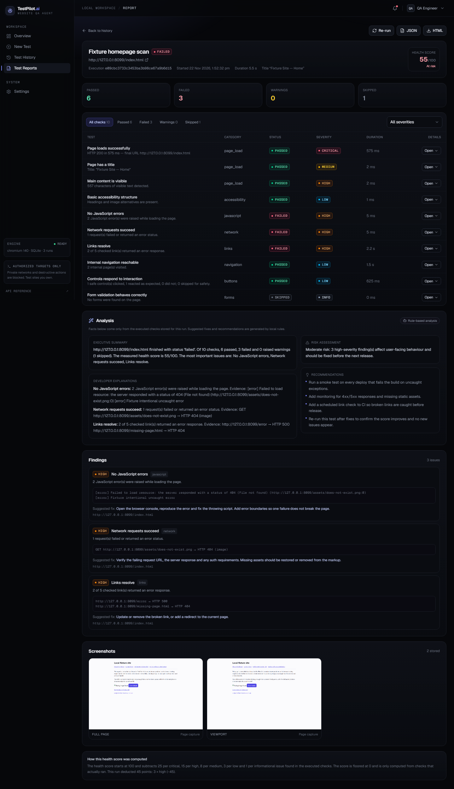
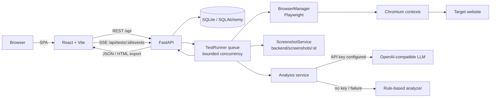
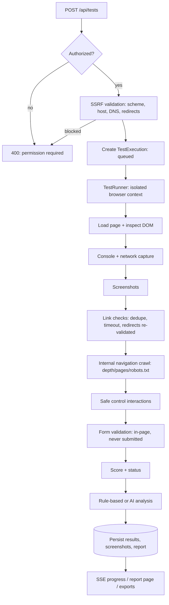

# TestPilot AI

**An autonomous website testing agent.** Give it a URL; it opens the site in a real
headless Chromium browser, checks loading, links, navigation, forms and safe
interactions, records console and network failures, captures screenshots, scores the
site's health, and produces an exportable report with an optional AI-written analysis.

TestPilot AI is a working application, not a dashboard mockup: every statistic comes
from the SQLite database, every run launches a real browser, and every report reflects
checks that actually executed.




> The screenshots above were captured from this repository running locally against the
> bundled fixture website. No live demo URL is published.

---

## Contents

- [Features](#features)
- [Architecture](#architecture)
- [Browser testing workflow](#browser-testing-workflow)
- [Technology stack](#technology-stack)
- [Repository layout](#repository-layout)
- [Local development](#local-development)
- [The fixture website](#the-fixture-website)
- [Environment variables](#environment-variables)
- [API](#api)
- [Health score](#health-score)
- [AI analysis](#ai-analysis)
- [Tests](#tests)
- [Docker](#docker)
- [CI/CD](#cicd)
- [Deployment guide](#deployment-guide)
- [Security and responsible usage](#security-and-responsible-usage)
- [Troubleshooting](#troubleshooting)
- [Limitations](#limitations)
- [Roadmap](#roadmap)
- [Publishing to GitHub](#publishing-to-github)
- [Contributing](#contributing)
- [License](#license)

---

## Features

**Testing engine (real Playwright automation)**

- Page load: HTTP status, navigation timeouts, document title, visible content and
  blank-page detection.
- Link checking: internal and external links, missing/empty `href`s, redirect chains,
  deduplication, bounded count, polite concurrency and per-request timeouts. Blocked
  or rate-limited responses (401/403/429) are reported as **inconclusive**, never as
  broken.
- Navigation: bounded internal crawl by depth/page count with a `robots.txt` check.
- Controls: only demonstrably safe buttons are clicked; destructive, financial,
  credential and ambiguous controls are recorded as **skipped with a reason**.
- Forms: labels, required fields, input types and constraint validation exercised
  in-page — **nothing is ever submitted**.
- Console errors: uncaught exceptions and console errors, with source URL/line.
- Network monitoring: failed requests and 4xx/5xx responses by resource type, without
  cookies, auth headers or request bodies.
- Screenshots: full-page, viewport and failure captures, stored per execution and
  served through an authenticated-path API endpoint.

**Execution**

- Isolated browser context per run, bounded concurrency, cancellation, duplicate
  protection, hard timeouts and crash/error containment.
- Statuses: `pending`, `queued`, `running`, `passed`, `failed`, `warnings`,
  `cancelled`, `error`. A run can never pass if a critical/high check failed.
- Live progress over **Server-Sent Events**, with polling fallback in the UI.

**Reports**

- Weighted health score with an auditable deduction breakdown.
- Passed / failed / warning / skipped summary, filterable result table, severity
  badges, full evidence per check.
- Issues with severity, evidence and suggested fixes.
- AI executive summary, risk assessment, recommendations and developer explanations —
  or a deterministic rule-based analysis when no key is configured.
- JSON and self-contained HTML export (screenshots embedded as data URIs).
- Screenshot gallery with expand/download and association to findings.

**Workspace**

- Overview dashboard: real statistics, activity chart, latest health summary.
- New Test form with client and server validation, SSRF checks, authorization notice
  and a live execution panel.
- Test history: search, status filter, sorting, pagination, re-run (never overwrites
  history) and delete with confirmation.
- Reports library and settings (defaults, AI, screenshots, verified system status).

**Engineering**

- 91 backend tests (API, SSRF, DB, state machine, link checker, monitor, reports, AI
  fallback, exports) and 14 frontend tests, all passing in this revision.
- Ruff lint + format, ESLint, TypeScript strict mode, production build.
- Docker images for both services, one-command Compose stack, health checks,
  non-root users, persistent volume.
- Four GitHub Actions workflows: backend CI, frontend CI, integration CI (headless
  Chromium + local fixture site) and a gated deployment workflow.

---

## Architecture



The API never blocks while a test runs: navigation happens in an asyncio background
task, results are persisted as each check finishes, and the SSE endpoint streams the
growing result set.

## Browser testing workflow



## Technology stack

| Layer | Technology |
| --- | --- |
| Frontend | React 19, TypeScript, Vite 7, Tailwind CSS 4, Lucide icons, Recharts, React Router, native `fetch` + `EventSource` |
| Backend | Python 3.12, FastAPI, Pydantic v2, SQLAlchemy 2, SQLite |
| Automation | Playwright (async API), Chromium |
| AI | Provider-agnostic interface; OpenAI-compatible chat completions; deterministic rule-based fallback |
| Testing | pytest, pytest-asyncio, httpx, Vitest, Testing Library, jsdom |
| Quality | Ruff (lint + format), ESLint, TypeScript strict |
| DevOps | Docker multi-stage builds, Compose, GitHub Actions, GHCR |

---

## Repository layout

```
testpilot-ai/
├── backend/
│   ├── app/
│   │   ├── api/                # dashboard, tests, settings routers + serializers
│   │   ├── core/               # config, SSRF-safe URL validation
│   │   ├── database/           # engine, session, UTC datetime type, init
│   │   ├── services/
│   │   │   ├── ai/             # provider interface, OpenAI provider, rule-based engine
│   │   │   ├── browser/        # browser manager, inspector, link checker,
│   │   │   │                   # interaction/form testers, monitor, screenshots, runner
│   │   │   └── reporting/      # scoring + JSON/HTML export
│   │   ├── models.py           # ORM models
│   │   ├── schemas.py          # API schemas
│   │   └── main.py             # FastAPI app, CORS, lifespan, SPA mount
│   ├── tests/                  # 9 test modules incl. browser integration
│   ├── Dockerfile
│   ├── pyproject.toml          # pytest + ruff configuration
│   └── requirements*.txt
├── frontend/
│   ├── src/
│   │   ├── components/         # UI kit, toasts
│   │   ├── layouts/            # sidebar/topbar shell
│   │   ├── pages/              # Overview, NewTest, History, Reports, Report, Settings
│   │   ├── test/               # Vitest setup, fixtures, page tests
│   │   ├── api.ts, types.ts, lib/format.ts
│   │   └── main.tsx, App.tsx, styles.css
│   ├── Dockerfile, nginx.conf
│   └── package.json, vite.config.ts, eslint.config.js
├── test-sites/fixtures/local_test_site/   # fixture website + server.py
├── docs/                       # real screenshots used above
├── .github/                    # CI workflows, issue/PR templates, Dependabot
├── CONTRIBUTING.md             # setup, checks and pull request expectations
├── CODE_OF_CONDUCT.md          # Contributor Covenant 2.1
├── SECURITY.md                 # private vulnerability reporting policy
├── LICENSE                     # MIT
├── docker-compose.yml          # local full stack
├── docker-compose.prod.yml     # SHA-tagged images for deployment
└── .env.example
```

---

## Local development

### Prerequisites

- Python **3.12+**
- Node.js **20+** and npm
- ~400 MB disk for Chromium

### 1. Backend

```bash
cd backend
python -m venv .venv

# Windows (Git Bash / PowerShell)
./.venv/Scripts/python.exe -m pip install -r requirements-dev.txt
./.venv/Scripts/python.exe -m playwright install chromium

# macOS / Linux
source .venv/bin/activate
pip install -r requirements-dev.txt
python -m playwright install chromium
```

Run it:

```bash
cd backend
./.venv/Scripts/python.exe -m uvicorn app.main:app --reload --port 8000
# macOS/Linux: uvicorn app.main:app --reload --port 8000
```

- API: <http://127.0.0.1:8000/api>
- Swagger UI: <http://127.0.0.1:8000/api/docs>
- Health: <http://127.0.0.1:8000/api/health>

The SQLite database (`backend/data/testpilot.db`) and screenshot directories are
created automatically on startup.

### 2. Frontend

```bash
cd frontend
npm ci
npm run dev
```

Open <http://localhost:5173>. Vite proxies `/api` (including SSE) to
`http://127.0.0.1:8000`.

Useful scripts:

| Command | Purpose |
| --- | --- |
| `npm run dev` | Dev server with proxy |
| `npm run build` | Typecheck + production bundle in `dist/` |
| `npm run typecheck` | `tsc --noEmit` |
| `npm run lint` | ESLint |
| `npm test` | Vitest |

### 3. First test

Use a site you own (for example your own staging URL), or the bundled fixture site
below. Confirm the authorization checkbox and press **Run test**.

## The fixture website

`test-sites/fixtures/local_test_site/` contains a deliberately mixed-quality site used
by the integration tests and safe for demos:

| Path | Behaviour |
| --- | --- |
| `/index.html` | Healthy content **plus** a broken link, a missing image, an uncaught JS error, a safe toggle button |
| `/about.html` | Fully healthy page |
| `/form.html` | Form with required name and `type="email"` validation; submit only shows a local message |
| `/missing-page.html` | 404 |
| `/slow` | Responds after 2 seconds |
| `/error` | HTTP 500 |

```bash
# terminal 1
python test-sites/fixtures/local_test_site/server.py --port 8099

# terminal 2 — allow private targets for the fixture only
cd backend
TESTPILOT_ALLOW_LOCAL_TARGETS=true ./.venv/Scripts/python.exe -m uvicorn app.main:app --port 8000
```

Then test `http://127.0.0.1:8099/index.html`. A real run detects 2 broken links, the
missing image, the uncaught error and computes a failing health score, while
`/about.html` passes.

> `TESTPILOT_ALLOW_LOCAL_TARGETS=true` disables SSRF protection. Use it only for local
> fixtures; never on a deployed instance.

---

## Environment variables

Copy `.env.example` to `.env` (or export the variables). All backend variables use the
`TESTPILOT_` prefix.

| Variable | Default | Purpose |
| --- | --- | --- |
| `TESTPILOT_DATABASE_URL` | `sqlite:///./data/testpilot.db` | SQLAlchemy URL (absolute when containerised) |
| `TESTPILOT_SCREENSHOT_DIR` | `./screenshots` | Screenshot storage root |
| `TESTPILOT_REPORT_DIR` | `./reports` | Report/JUnit artifact directory |
| `TESTPILOT_ALLOWED_ORIGINS` | localhost dev origins | JSON array of allowed browser origins |
| `TESTPILOT_DEFAULT_TIMEOUT_SECONDS` | `60` | Default per-navigation timeout (10–300) |
| `TESTPILOT_DEFAULT_MAX_PAGES` | `5` | Default pages per run (hard cap 25) |
| `TESTPILOT_DEFAULT_MAX_LINKS` | `25` | Default links per run (hard cap 100) |
| `TESTPILOT_DEFAULT_MAX_DEPTH` | `1` | Default crawl depth (0–3) |
| `TESTPILOT_DEFAULT_BROWSER` | `chromium` | Default engine |
| `TESTPILOT_MAX_CONCURRENCY` | `2` | Concurrent executions per process |
| `TESTPILOT_MAX_PAGES_HARD_LIMIT` | `25` | Absolute page ceiling |
| `TESTPILOT_MAX_LINKS_HARD_LIMIT` | `100` | Absolute link ceiling |
| `TESTPILOT_OUTBOUND_REDIRECT_LIMIT` | `3` | Redirect hops per outbound request |
| `TESTPILOT_ALLOW_LOCAL_TARGETS` | `false` | **Dev/test only:** allow localhost/private targets |
| `TESTPILOT_AI_ENABLED` | `true` | Master switch for AI analysis |
| `TESTPILOT_AI_PROVIDER` | `openai` | Provider label |
| `TESTPILOT_AI_API_KEY` / `AI_API_KEY` / `OPENAI_API_KEY` | — | Server-side key (aliases accepted) |
| `TESTPILOT_AI_BASE_URL` | `https://api.openai.com/v1` | OpenAI-compatible endpoint |
| `TESTPILOT_AI_MODEL` | `gpt-4o-mini` | Model name |
| `TESTPILOT_AI_TIMEOUT_SECONDS` | `30` | Provider timeout |
| `VITE_API_BASE` (frontend) | empty | Optional API base; same-origin by default |

Secrets are only read by the backend and are never returned by any endpoint.

---

## API

Base path `/api`. Interactive docs at `/api/docs`.

| Method | Path | Description |
| --- | --- | --- |
| GET | `/api/health` | Liveness + database check |
| GET | `/api/dashboard` | Stats, recent runs, activity, health |
| GET | `/api/dashboard/stats` | Aggregate statistics |
| GET | `/api/dashboard/activity?days=14` | Daily pass/fail series |
| POST | `/api/tests` | Create + queue a test |
| GET | `/api/tests` | Paginated history (`page`, `page_size`, `status`, `search`, `sort`, `order`) |
| GET | `/api/tests/{id}` | Execution with results, screenshots, progress |
| POST | `/api/tests/{id}/rerun` | Queue a new execution with the same configuration |
| POST | `/api/tests/{id}/cancel` | Request cancellation |
| DELETE | `/api/tests/{id}` | Delete execution, results and screenshots |
| GET | `/api/tests/{id}/report` | Full report payload |
| GET | `/api/tests/{id}/results` | Results only |
| GET | `/api/tests/{id}/screenshots` | Screenshot metadata |
| GET | `/api/tests/{id}/screenshots/{sid}/file?download=1` | PNG file |
| GET | `/api/tests/{id}/export/json` | JSON export (attachment) |
| GET | `/api/tests/{id}/export/html` | Self-contained HTML export |
| GET | `/api/tests/{id}/events` | Server-Sent Events progress stream |
| GET | `/api/settings` | Workspace defaults + AI key status |
| PUT | `/api/settings` | Update defaults |
| GET | `/api/system/info` | Verified backend/browser/database status |

Example:

```bash
curl -X POST http://127.0.0.1:8000/api/tests \
  -H 'Content-Type: application/json' \
  -d '{"url":"https://staging.example.com","name":"Smoke","authorized":true,
       "config":{"max_pages":3,"max_links":10,"timeout_seconds":30}}'

curl -N http://127.0.0.1:8000/api/tests/<id>/events
```

---

## Health score

Every completed run starts at **100** and subtracts weighted penalties for each
failed or warning check:

| Severity | Deduction |
| --- | --- |
| Critical | 25 |
| High | 15 |
| Medium | 8 |
| Low | 3 |
| Informational | 1 |

The score floors at 0. The exact deduction breakdown for each run is stored in the
execution summary and shown on the report page, so the number is always explainable.
Run status: any **critical or high** failure ⇒ `failed`; lower-severity problems ⇒
`warnings`; otherwise `passed`.

## AI analysis

- Provider interface: `app/services/ai/base.py`; OpenAI-compatible implementation in
  `openai_provider.py` — add another provider by implementing `analyze(payload)`.
- The model receives **only the recorded facts** (URL, checks, statuses, messages) and
  is instructed not to invent tests or errors. Findings, suggested fixes,
  recommendations and risk statements are labelled as generated guidance; detected
  facts stay separate.
- Without a key, or when the provider errors, the deterministic rule-based analyzer
  runs and the report says `Rule-based analysis`. The application never crashes or
  silently omits the section.
- Configure with `AI_API_KEY` (or `OPENAI_API_KEY`) in the backend environment.

---

## Tests

```bash
# Backend (91 tests: unit + integration; launches real Chromium)
cd backend
pytest

# Lint + format
ruff check app tests
ruff format --check app tests

# Frontend (14 tests)
cd frontend
npm test
npm run typecheck
npm run lint
```

Backend coverage highlights:

| Module | What is verified |
| --- | --- |
| `test_security.py` | Scheme/host validation, private IP ranges, metadata endpoints, DNS-to-private resolution, explicit local override |
| `test_api.py` | Authorization, URL rejection, config validation, pagination/search/sort, cancel/delete, dashboard math, reports, exports, SSE |
| `test_database.py` | Persistence, UTC round-trip, cascade delete |
| `test_runner.py` | Status transitions, cancellation, duplicate-task guard |
| `test_link_checker.py` | Deduplication, classification, real 404/500 detection, max-link cap, blocked targets |
| `test_monitor.py` | Console/warning separation, request-failure dedupe, no secrets captured |
| `test_reports.py` | Scoring, status policy, JSON/HTML export, AI fallback |
| `test_integration.py` | Full scans of the fixture: defect detection, form validation, HTTP 500, screenshots, exports |

Frontend tests cover dashboard rendering and empty states, URL validation and
authorization on the new-test form, live-panel start, report rendering, result
filtering, exports and history search/delete confirmation.

---

## Docker

```bash
docker compose up --build
```

- Frontend: <http://localhost:8080>
- Backend API: <http://localhost:8000/api/docs>

The stack uses two multi-stage images: Python 3.12 + Chromium (non-root, health
checked) and a Vite build served by unprivileged nginx (port 8080, `/api` proxied with
SSE buffering disabled). Data is persisted in the `testpilot-data` volume
(`/data/testpilot.db`, `/data/screenshots`).

```bash
# logs
docker compose logs -f backend

# stop
docker compose down

# stop and delete the database + screenshots volume
docker compose down -v

# rebuild after changes
docker compose up --build --force-recreate
```

Pass an AI key without writing it into an image:

```bash
AI_API_KEY=sk-... docker compose up -d
```

## CI/CD

| Workflow | Trigger | What it does |
| --- | --- | --- |
| `backend-ci.yml` | push/PR to `main`, manual | Ruff lint, `ruff format --check`, pytest with Chromium, JUnit artifact |
| `frontend-ci.yml` | push/PR to `main`, manual | `npm ci`, ESLint, Vitest, typecheck, production build, dist artifact |
| `integration.yml` | push/PR to `main`, manual | Installs Chromium, verifies automation launches, builds frontend, runs browser tests, boots the API, runs a real scan of the fixture through the API and exports it |
| `deploy.yml` | after successful Backend/Frontend CI on `main`, or manual | Builds and pushes SHA-tagged backend/frontend images to GHCR; optionally deploys over SSH |

`deploy.yml` only deploys from `main`, has a non-cancelling `production` concurrency
group, uses least-privilege permissions (`contents: read`, `packages: write`), and
publishes images tagged with the commit SHA. If `DEPLOY_HOST`, `DEPLOY_USER` and
`DEPLOY_SSH_KEY` are absent it publishes images and prints a notice — it does not
claim a deployment happened.

### Deployment secrets

| Secret | Required | Purpose |
| --- | --- | --- |
| `GITHUB_TOKEN` | automatic | Push to GHCR |
| `DEPLOY_HOST` | optional | SSH host |
| `DEPLOY_USER` | optional | SSH user |
| `DEPLOY_SSH_KEY` | optional | Private key (dedicated deploy key) |
| `DEPLOY_PATH` | optional | Directory containing `docker-compose.prod.yml` (default `/opt/testpilot-ai`) |
| `AI_API_KEY` | optional | Set on the host/.env, not in the repo |

## Deployment guide

1. Push the repository to GitHub and enable Actions.
2. Let **Backend CI**, **Frontend CI** and **Integration CI** pass on `main`.
3. Images are published to `ghcr.io/<owner>/<repo>-backend:<sha>` and
   `ghcr.io/<owner>/<repo>-frontend:<sha>`.
4. On your host, install Docker and copy `docker-compose.prod.yml`.
5. Create a `.env` next to it:

   ```bash
   AI_API_KEY=sk-...            # optional
   TESTPILOT_AI_MODEL=gpt-4o-mini
  ```

6. Put a TLS reverse proxy (Caddy, nginx, Traefik) in front of port 8080, set
   `TESTPILOT_ALLOWED_ORIGINS` to your public origin, and keep
   `TESTPILOT_ALLOW_LOCAL_TARGETS=false`.
7. Add the deployment secrets, run the **Deploy** workflow (manual runs require
   ticking `deploy`).
8. Add authentication at the proxy/SSO layer before exposing TestPilot publicly; the
   app intentionally has no user accounts.

Back up the `testpilot-data` volume (database + screenshots).

---

## Security and responsible usage

TestPilot is a QA tool for sites you own or are explicitly authorized to test.

- **SSRF protection** on the initial URL, every redirect hop and every outbound link
  request: HTTP(S) only, no credentials in URLs, no loopback/private/link-local/
  CGNAT/metadata addresses, DNS resolved and every address validated.
- **No destructive actions**: purchases, messages, bookings, deletions, credential
  changes and ambiguous controls are skipped and reported.
- **No credential use**, no CAPTCHA bypass, no auth circumvention, no brute force, no
  vulnerability exploitation, no flooding.
- **Bounded crawling**, bounded link counts, per-request timeouts, a small delay
  between link checks, and `robots.txt` respected for crawling.
- **Privacy**: request bodies, cookies, `Authorization` headers and tokens are never
  stored; only method, URL, status, resource type and failure text.
- **Secrets**: the AI key lives only in the server environment.

See [SECURITY.md](SECURITY.md) for the full policy and reporting process.

## Troubleshooting

| Symptom | Fix |
| --- | --- |
| `Could not launch the chromium browser engine` | Run `python -m playwright install chromium` (inside the venv) |
| `Executable doesn't exist … playwright install` | Same as above; in Docker rebuild the backend image |
| `Local and private network targets are blocked` | Use a public site, or set `TESTPILOT_ALLOW_LOCAL_TARGETS=true` only for the fixture |
| Dashboard shows `Could not reach the TestPilot API` | Start the backend on port 8000; check the Vite proxy target |
| Live panel shows “Live stream unavailable” | A proxy is buffering SSE; the UI falls back to polling. In nginx set `proxy_buffering off` (already configured) |
| `409` when starting a test | An identical URL is already queued/running; wait or cancel it |
| AI section says `Rule-based analysis` | No key configured, or the provider failed; check the message and `TESTPILOT_AI_MODEL`/base URL |
| Screenshots return 404 | The run had capture disabled, or files were removed from the volume |
| Port already in use | Change `--port` for uvicorn / `server.port` in `vite.config.ts` |
| pytest prints a pipe warning on Windows | Harmless teardown warning from Playwright subprocesses; the JUnit XML still records every test |
| Docker build cannot fetch browsers | Check network/proxy access to Playwright's CDN during image build |

## Limitations

- Single-node SQLite storage; not a multi-tenant SaaS (no accounts, by design).
- In-process job queue: a restart cancels in-flight runs (they are marked `cancelled`/`error`,
  never left `running` silently forever).
- AI analysis requires your own key; quality depends on the provider.
- PDF export is not implemented (JSON and HTML are).
- Firefox/WebKit are selectable but require `playwright install firefox|webkit` and are
  not exercised by CI.
- Automated interaction coverage is deliberately conservative; complex SPA flows need
  scripted journeys (future work).
- Health scoring is heuristic, not a security or accessibility audit.
- DNS-rebinding protection is best-effort.
- Docker images were **not built in this environment** because the Docker daemon was
  not running; the Compose files validate and the Dockerfiles follow the documented
  Playwright/nginx recipes, but build the images once on your machine.

## Roadmap

- PDF report export and scheduled/recurring scans.
- Accessibility rules (axe-core) and visual regression diffs.
- Scripted journeys (recorded steps) and authenticated test profiles.
- PostgreSQL backend and an external job queue for horizontal scaling.
- GitHub App / PR check integration and Slack notifications.

---

## Publishing to GitHub

The repository is initialised locally with a single `main` commit, so publishing is a
push away. Create an **empty** repository on GitHub (no README, license, or `.gitignore`
— the repository already has all three), then:

```bash
git remote add origin https://github.com/<your-user>/<your-repo>.git
git push -u origin main
```

After the first push, finish the repository settings:

1. **Actions** → allow workflows to run; confirm `Backend CI`, `Frontend CI` and
   `Integration CI` are green.
2. **Settings → Secrets and variables → Actions** → add `DEPLOY_HOST`, `DEPLOY_USER`,
   `DEPLOY_SSH_KEY` and `DEPLOY_PATH` only if you intend to use `deploy.yml`.
3. **Settings → Branches** → protect `main`: require a pull request and the three CI
   checks before merging.
4. **Settings → General** → enable Dependabot alerts; `.github/dependabot.yml` already
   schedules weekly Python, npm and Actions updates.
5. Add a description and topics (`playwright`, `fastapi`, `react`, `website-testing`)
   so the project is discoverable.

Notes:

- `.env`, `backend/data/`, `backend/screenshots/*`, `frontend/node_modules/` and
  `frontend/dist/` are ignored — no secrets or build output are committed.
- Do not commit an API key. Set `AI_API_KEY` as an environment variable or a GitHub
  Actions secret for deployment.
- After the first push, open the **Actions** tab and confirm the three CI workflows
  are green before enabling the deploy workflow.

## Contributing

Contributions are welcome. Read [CONTRIBUTING.md](CONTRIBUTING.md) for the development
setup, the exact commands CI runs, and what a reviewable pull request looks like. By
taking part you agree to the [Code of Conduct](CODE_OF_CONDUCT.md).

Please report vulnerabilities privately as described in [SECURITY.md](SECURITY.md) rather
than in a public issue.

## License

Released under the [MIT License](LICENSE) — copyright © 2026 TestPilot AI contributors.
You may use, modify and redistribute the code, including commercially, provided the
copyright notice and permission notice are retained.
