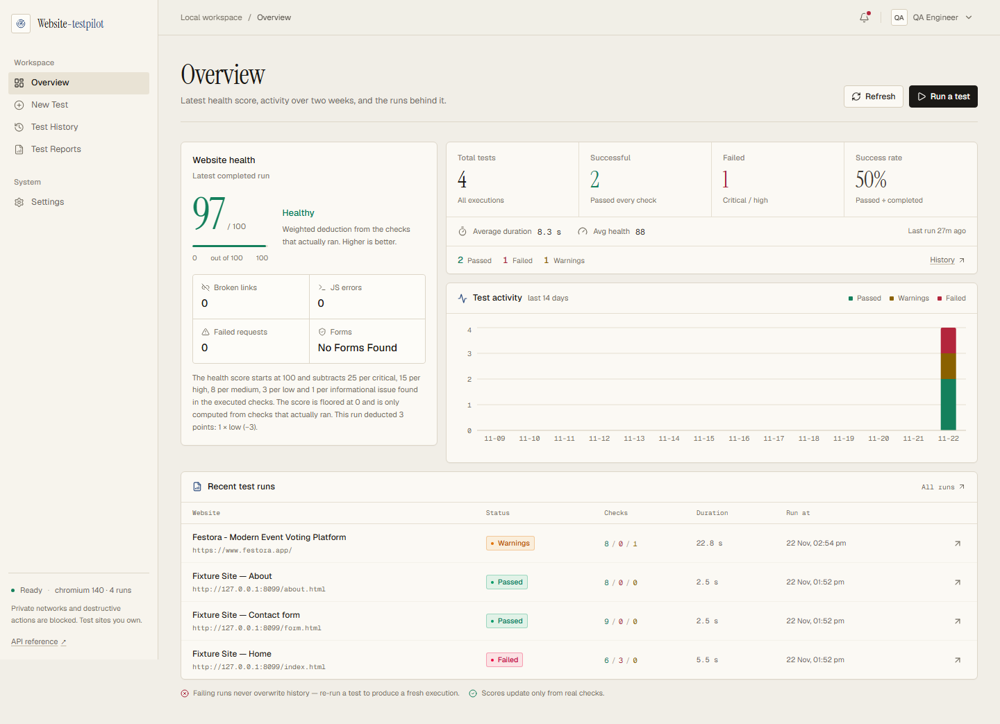
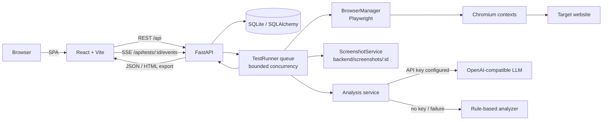

# TestPilot AI

**An autonomous website testing agent.**

Give it a URL; it opens the site in a real headless Chromium browser, checks loading, links, navigation, forms and safe interactions, records console and network failures, captures screenshots, scores the site's health, and produces an exportable report with an optional AI-written analysis.

TestPilot AI is a working application, not a dashboard mockup: every statistic comes from the SQLite database, every run launches a real browser, and every report reflects checks that actually executed.




> The screenshots above were captured from this repository running locally against the bundled fixture website. No live demo URL is published.

---

## Contents

- [Features](#features)
- [Architecture](#architecture)
- [Browser testing workflow](#browser-testing-workflow)
- [Technology stack](#technology-stack)
- [Repository layout](#repository-layout)
- [Local development](#local-development)
- [The fixture website](#the-fixture-website)
- [Environment variables](#environment-variables)
- [API](#api)
- [Health score](#health-score)
- [AI analysis](#ai-analysis)
- [Tests](#tests)
- [Docker](#docker)
- [CI/CD](#cicd)
- [Deployment guide](#deployment-guide)
- [Security and responsible usage](#security-and-responsible-usage)
- [Troubleshooting](#troubleshooting)
- [Limitations](#limitations)
- [Roadmap](#roadmap)
- [Publishing to GitHub](#publishing-to-github)
- [Contributing](#contributing)
- [License](#license)

---

## Features

### Testing engine (real Playwright automation)

- **Page load:** HTTP status, navigation timeouts, document title, visible content and blank-page detection.
- **Link checking:** Internal and external links, missing/empty `href` values, redirect chains, deduplication, bounded count, polite concurrency and per-request timeouts. Blocked or rate-limited responses (`401`, `403`, `429`) are reported as **inconclusive**, never as broken.
- **Navigation:** Bounded internal crawl by depth/page count with a `robots.txt` check.
- **Controls:** Only demonstrably safe buttons are clicked. Destructive, financial, credential-related and ambiguous controls are recorded as **skipped with a reason**.
- **Forms:** Labels, required fields, input types and constraint validation are exercised in-page — **nothing is ever submitted**.
- **Console errors:** Uncaught exceptions and console errors, with source URL and line.
- **Network monitoring:** Failed requests and `4xx`/`5xx` responses by resource type, without cookies, auth headers or request bodies.
- **Screenshots:** Full-page, viewport and failure captures, stored per execution and served through an API endpoint.

### Execution

- Isolated browser context per run, bounded concurrency, cancellation, duplicate protection, hard timeouts and crash/error containment.
- Statuses: `pending`, `queued`, `running`, `passed`, `failed`, `warnings`, `cancelled`, `error`.
- A run can never pass if a critical or high-severity check failed.
- Live progress over **Server-Sent Events (SSE)**, with polling fallback in the UI.

### Reports

- Weighted health score with an auditable deduction breakdown.
- Passed / failed / warning / skipped summary, filterable result table, severity badges and full evidence per check.
- Issues with severity, evidence and suggested fixes.
- AI executive summary, risk assessment, recommendations and developer explanations — or deterministic rule-based analysis when no API key is configured.
- JSON and self-contained HTML export (screenshots embedded as data URIs).
- Screenshot gallery with expand/download and association to findings.

### Workspace

- **Overview dashboard:** Real statistics, activity chart and latest health summary.
- **New Test:** Client and server validation, SSRF checks, authorization notice and live execution panel.
- **Test history:** Search, status filter, sorting, pagination, rerun (never overwrites history) and delete with confirmation.
- **Reports library:** Browse and review previous reports.
- **Settings:** Defaults, AI configuration, screenshots and verified system status.

### Engineering

- 91 backend tests (API, SSRF, DB, state machine, link checker, monitor, reports, AI fallback and exports) and 14 frontend tests, all passing in this revision.
- Ruff lint + format, ESLint, TypeScript strict mode and production build.
- Docker images for both services, one-command Compose stack, health checks, non-root users and persistent volume.
- Four GitHub Actions workflows: backend CI, frontend CI, integration CI (headless Chromium + local fixture site) and a gated deployment workflow.

---

## Architecture



The API never blocks while a test runs. Navigation happens in an asyncio background task, results are persisted as each check finishes, and the SSE endpoint streams the growing result set.

---

## Browser testing workflow


---

## Technology stack

| Layer | Technology |
|---|---|
| Frontend | React 19, TypeScript, Vite 7, Tailwind CSS 4, Lucide icons, Recharts, React Router, native `fetch` + `EventSource` |
| Backend | Python 3.12, FastAPI, Pydantic v2, SQLAlchemy 2, SQLite |
| Automation | Playwright (async API), Chromium |
| AI | Provider-agnostic interface; OpenAI-compatible chat completions; deterministic rule-based fallback |
| Testing | pytest, pytest-asyncio, httpx, Vitest, Testing Library, jsdom |
| Quality | Ruff (lint + format), ESLint, TypeScript strict |
| DevOps | Docker multi-stage builds, Compose, GitHub Actions, GHCR |

---

## Repository layout

```text
testpilot-ai/
├── backend/
│   ├── app/
│   │   ├── api/                # Dashboard, tests, settings routers + serializers
│   │   ├── core/               # Config, SSRF-safe URL validation
│   │   ├── database/            # Engine, session, UTC datetime type, init
│   │   ├── services/
│   │   │   ├── ai/             # Provider interface, OpenAI provider, rule-based engine
│   │   │   ├── browser/       # Browser manager, inspector, link checker,
│   │   │   │                 # interaction/form testers, monitor, screenshots, runner
│
│   │   │   └── reporting/      # Scoring + JSON/HTML export
│   │   ├── models.py            # ORM models
│   │   ├── schemas.py            # API schemas
│   │   └── main.py               # FastAPI app, CORS, lifespan, SPA mount
│   ├── tests/                    # 9 test modules, including browser integration
│   ├── Dockerfile
│   ├── pyproject.toml             # pytest + Ruff configuration
│   └── requirements*.txt
├── frontend/
│   ├── src/
│   │   ├── components/           # UI kit, toasts
│   │   ├── layouts/              # Sidebar/topbar shell
│   │   ├── pages/                # Overview, NewTest, History, Reports, Report, Settings
│   │   ├── test/                 # Vitest setup, fixtures, page tests
│   │   ├── api.ts, types.ts, lib/format.ts
│   │   ├── main.tsx, App.tsx, styles.css
│   │   └── ...
│   ├── Dockerfile
│   ├── nginx.conf
│   ├── package.json
│   └── vite.config.ts
├── test-sites/
│   └── fixtures/
│       └── local_test_site/       # Fixture website + server.py
├── docs/                          # Screenshots used above
├── .github/                        # CI workflows, issue/PR templates, Dependabot
├── CONTRIBUTING.md
├── CODE_OF_CONDUCT.md
├── SECURITY.md
├── LICENSE
├── docker-compose.yml
├── docker-compose.prod.yml
└── .env.example
```

---

## Local development

### Prerequisites

- Python **3.12+**
- Node.js **20+** and npm
- Approximately 400 MB of disk space for Chromium

### 1. Backend

```bash
cd backend
python -m venv .venv
```

**Windows (PowerShell / Git Bash):**

```bash
./.venv/Scripts/python.exe -m pip install -r requirements-dev.txt
./.venv/Scripts/python.exe -m playwright install chromium
```

**macOS / Linux:**

```bash
source .venv/bin/activate
pip install -r requirements-dev.txt
python -m playwright install chromium
```

Run the backend:

**Windows:**

```bash
cd backend
./.venv/Scripts/python.exe -m uvicorn app.main:app --reload --port 8000
```

**macOS / Linux:**

```bash
uvicorn app.main:app --reload --port 8000
```

Endpoints:

- API: http://127.0.0.1:8000/api
- Swagger UI: http://127.0.0.1:8000/api/docs
- Health: http://127.0.0.1:8000/api/health

The SQLite database (`backend/data/testpilot.db`) and screenshot directories are created automatically on startup.

### 2. Frontend

```bash
cd frontend
npm ci
npm run dev
```

Open http://localhost:5173.

Vite proxies `/api` (including SSE) to `http://127.0.0.1:8000`.

Useful scripts:

| Command | Purpose |
|---|---|
| `npm run dev` | Dev server with proxy |
| `npm run build` | Typecheck + production bundle in `dist/` |
| `npm run typecheck` | `tsc --noEmit` |
| `npm run lint` | ESLint |
| `npm test` | Vitest |

### 3. First test

Use a site you own (for example, your own staging URL), or the bundled fixture site below.

Confirm the authorization checkbox and press **Run test**.

---

## The fixture website

`test-sites/fixtures/local_test_site/` contains a deliberately mixed-quality website used by integration tests and safe for demos.

| Path | Behaviour |
|---|---|
| `/index.html` | Healthy content plus a broken link, missing image, uncaught JS error and safe toggle button |
| `/about.html` | Fully healthy page |
| `/form.html` | Form with required name and `type="email"` validation; submission only shows a local message |
| `/missing-page.html` | 404 |
| `/slow` | Responds after 2 seconds |
| `/error` | HTTP 500 |

Run the fixture:

```bash
# Terminal 1
python test-sites/fixtures/local_test_site/server.py --port 8099

# Terminal 2 (allow private targets for fixture only)
cd backend
TESTPILOT_ALLOW_LOCAL_TARGETS=true ./.venv/Scripts/python.exe -m uvicorn app.main:app --port 8000
```

Then test:

```text
http://127.0.0.1:8099/index.html
```

A real run detects two broken links, the missing image, the uncaught error and computes a failing health score, while `/about.html` passes.

> `TESTPILOT_ALLOW_LOCAL_TARGETS=true` disables SSRF protection. Use it only for local fixtures; never on a deployed instance.

---

## Environment variables

Copy `.env.example` to `.env` or export the variables.

All backend variables use the `TESTPILOT_` prefix.

| Variable | Default | Purpose |
|---|---|---|
| `TESTPILOT_DATABASE_URL` | `sqlite:///./data/testpilot.db` | SQLAlchemy URL (absolute when containerized) |
| `TESTPILOT_SCREENSHOT_DIR` | `./screenshots` | Screenshot storage root |
| `TESTPILOT_REPORT_DIR` | `./reports` | Report/JUnit artifact directory |
| `TESTPILOT_ALLOWED_ORIGINS` | localhost dev origins | JSON array of allowed browser origins |
| `TESTPILOT_DEFAULT_TIMEOUT_SECONDS` | `60` | Default navigation timeout (10–300 seconds) |
| `TESTPILOT_DEFAULT_MAX_PAGES` | `5` | Default pages per run (hard cap 25) |
| `TESTPILOT_DEFAULT_MAX_LINKS` | `25` | Default links per run (hard cap 100) |
| `TESTPILOT_DEFAULT_MAX_DEPTH` | `1` | Default crawl depth (0–3) |
| `TESTPILOT_DEFAULT_BROWSER` | `chromium` | Default browser engine |
| `TESTPILOT_MAX_CONCURRENCY` | `2` | Concurrent executions per process |
| `TESTPILOT_MAX_PAGES_HARD_LIMIT` | `25` | Absolute page ceiling |
| `TESTPILOT_MAX_LINKS_HARD_LIMIT` | `100` | Absolute link ceiling |
| `TESTPILOT_OUTBOUND_REDIRECT_LIMIT` | `3` | Redirect hops per outbound request |
| `TESTPILOT_ALLOW_LOCAL_TARGETS` | `false` | Development/test only: allow localhost/private targets |
| `TESTPILOT_AI_ENABLED` | `true` | Master switch for AI analysis |
| `TESTPILOT_AI_PROVIDER` | `openai` | Provider label |
| `TESTPILOT_AI_API_KEY` / `AI_API_KEY` / `OPENAI_API_KEY` | — | Server-side key (aliases accepted) |
| `TESTPILOT_AI_BASE_URL` | `https://api.openai.com/v1` | OpenAI-compatible endpoint |
| `TESTPILOT_AI_MODEL` | `gpt-4o-mini` | Model name |
| `TESTPILOT_AI_TIMEOUT_SECONDS` | `30` | Provider timeout |
| `VITE_API_BASE` (frontend) | empty | Optional API base; same-origin by default |

Secrets are only read by the backend and are never returned by any endpoint.

---

## API

Base path: `/api`

Interactive documentation: http://127.0.0.1:8000/api/docs

| Method | Path | Description |
|---|---|---|
| `GET` | `/api/health` | Liveness + database check |
| `GET` | `/api/dashboard` | Stats, recent runs, activity, health |
| `GET` | `/api/dashboard/stats` | Aggregate statistics |
| `GET` | `/api/dashboard/activity?days=14` | Daily pass/fail series |
| `POST` | `/api/tests` | Create + queue a test |
| `GET` | `/api/tests` | Paginated history (`page`, `page_size`, `status`, `search`, `sort`, `order`) |
| `GET` | `/api/tests/{id}` | Execution with results, screenshots and progress |
| `POST` | `/api/tests/{id}/rerun` | Queue a new execution with the same configuration |
| `POST` | `/api/tests/{id}/cancel` | Request cancellation |
| `DELETE` | `/api/tests/{id}` | Delete execution, results and screenshots |
| `GET` | `/api/tests/{id}/report` | Full report payload |
| `GET` | `/api/tests/{id}/results` | Results only |
| `GET` | `/api/tests/{id}/screenshots` | Screenshot metadata |
| `GET` | `/api/tests/{id}/screenshots/{sid}/file?download=1` | PNG file |
| `GET` | `/api/tests/{id}/export/json` | JSON export (attachment) |
| `GET` | `/api/tests/{id}/export/html` | Self-contained HTML export |
| `GET` | `/api/tests/{id}/events` | Server-Sent Events progress stream |
| `GET` | `/api/settings` | Workspace defaults + AI key status |
| `PUT` | `/api/settings` | Update defaults |
| `GET` | `/api/system/info` | Verified backend/browser/database status |

### Example

```bash
curl -X POST http://127.0.0.1:8000/api/tests \
  -H "Content-Type: application/json" \
  -d '{
    "url": "https://staging.example.com",
    "name": "Smoke",
    "authorized": true,
    "config": {
      "max_pages": 3,
      "max_links": 10,
      "timeout_seconds": 30
    }
  }'

curl -N http://127.0.0.1:8000/api/tests/<id>/events
```

---

## Health score

Every completed run starts at **100** and subtracts weighted penalties for failed or warning checks.

| Severity | Deduction |
|---|---:|
| Critical | 25 |
| High | 15 |
| Medium | 8 |
| Low | 3 |
| Informational | 1 |

The score floors at 0.

The exact deduction breakdown for each run is stored in the execution summary and shown on the report page, so the score is always explainable.

**Run status:**

- Any critical or high failure → `failed`
- Lower-severity problems → `warnings`
- No issues → `passed`

---

## AI analysis

- Provider interface: `app/services/ai/base.py`; OpenAI-compatible implementation in `openai_provider.py`. Additional providers can be added by implementing `analyze(payload)`.
- The model receives **only recorded facts** (URL, checks, statuses and messages) and is instructed not to invent tests or errors.
- Findings, suggested fixes, recommendations and risk statements are labelled as generated guidance; detected facts stay separate.
- Without a key, or when the provider errors, the deterministic rule-based analyzer runs. The report identifies the analysis as **Rule-based analysis**.
- Configure with `AI_API_KEY` (or `OPENAI_API_KEY`) in the backend environment.

---

## Tests

```bash
# Backend (91 tests: unit + integration; launches real Chromium)
cd backend
pytest

# Lint
ruff check app tests

# Format check
ruff format --check app tests

# Frontend (14 tests)
cd frontend
npm test
npm run typecheck
npm run lint
```

### Backend coverage highlights

| Module | What is verified |
|---|---|
| `test_security.py` | Scheme/host validation, private IP ranges, metadata endpoints, DNS-to-private resolution, explicit local override |
| `test_api.py` | Authorization, URL rejection, config validation, pagination/search/sort, cancel/delete, dashboard math, reports, exports, SSE |
| `test_database.py` | Persistence, UTC round-trip, cascade delete |
| `test_runner.py` | Status transitions, cancellation, duplicate-task guard |
| `test_link_checker.py` | Deduplication, classification, real 404/500 detection, max-link cap, blocked targets |
| `test_monitor.py` | Console/warning separation, request-failure dedupe, no secrets captured |
| `test_reports.py` | Scoring, status policy, JSON/HTML export, AI fallback |
| `test_integration.py` | Full fixture scans: defect detection, form validation, HTTP 500, screenshots, exports |

Frontend tests cover dashboard rendering and empty states, URL validation and authorization on the new-test form, live-panel start, report rendering, result filtering, exports, history search and delete confirmation.

---

## Docker

Start the full stack:

```bash
docker compose up --build
```

- Frontend: http://localhost:8080
- Backend API: http://localhost:8000/api/docs

The stack uses two multi-stage images:

- Python 3.12 + Chromium backend (non-root, health checked)
- Vite build served by unprivileged nginx (port 8080, `/api` proxied with SSE buffering disabled)

Data is persisted in the `testpilot-data` volume (`/data/testpilot.db`, `/data/screenshots`).

Useful commands:

```bash
# Logs
docker compose logs -f backend

# Stop
docker compose down

# Stop and delete the database + screenshots volume
docker compose down -v

# Rebuild after changes
docker compose up --build --force-recreate
```

Pass an AI key without writing it into an image:

```bash
AI_API_KEY=sk-... docker compose up -d
```

---

## CI/CD

| Workflow | Trigger | What it does |
|---|---|---|
| `backend-ci.yml` | Push/PR to `main`, manual | Ruff lint, format check, pytest with Chromium, JUnit artifact |
| `frontend-ci.yml` | Push/PR to `main`, manual | `npm ci`, ESLint, Vitest, typecheck, production build, dist artifact |
| `integration.yml` | Push/PR to `main`, manual | Installs Chromium, verifies automation launches, builds frontend, runs browser tests, boots API, runs a real fixture scan and exports it |
| `deploy.yml` | After successful Backend/Frontend CI on `main`, or manual | Builds and pushes SHA-tagged backend/frontend images to GHCR; optionally deploys over SSH |

`deploy.yml` only deploys from `main`, has a non-cancelling `production` concurrency group, uses least-privilege permissions (`contents: read`, `packages: write`) and publishes images tagged with the commit SHA.

If `DEPLOY_HOST`, `DEPLOY_USER` and `DEPLOY_SSH_KEY` are absent, it publishes images and prints a notice — it does not claim a deployment happened.

### Deployment secrets

| Secret | Required | Purpose |
|---|---|---|
| `GITHUB_TOKEN` | Automatic | Push to GHCR |
| `DEPLOY_HOST` | Optional | SSH host |
| `DEPLOY_USER` | Optional | SSH user |
| `DEPLOY_SSH_KEY` | Optional | Private key (dedicated deploy key) |
| `DEPLOY_PATH` | Optional | Directory containing `docker-compose.prod.yml` (default `/opt/testpilot-ai`) |
| `AI_API_KEY` | Optional | Set on the host or `.env`, not in the repository |

---

## Deployment guide

1. Push the repository to GitHub and enable Actions.
2. Let **Backend CI**, **Frontend CI** and **Integration CI** pass on `main`.
3. Images are published to:
   - `ghcr.io/<owner>/<repo>-backend:<sha>`
   - `ghcr.io/<owner>/<repo>-frontend:<sha>`
4. On your host, install Docker and copy `docker-compose.prod.yml`.
5. Create a `.env` next to it:

   ```bash
   AI_API_KEY=sk-...            # Optional
   TESTPILOT_AI_MODEL=gpt-4o-mini
   ```

6. Put a TLS reverse proxy (Caddy, nginx or Traefik) in front of port 8080, set `TESTPILOT_ALLOWED_ORIGINS` to your public origin and keep `TESTPILOT_ALLOW_LOCAL_TARGETS=false`.
7. Add deployment secrets and run the **Deploy** workflow. Manual runs require ticking the `deploy` option.
8. Add authentication at the proxy or SSO layer before exposing TestPilot publicly. The app intentionally has no user accounts.

Back up the `testpilot-data` volume (database + screenshots).

---

## Security and responsible usage

TestPilot AI is a QA tool for sites you own or are explicitly authorized to test.

- **SSRF protection:** Initial URL, every redirect hop and every outbound link request are validated. HTTP(S) only, no credentials in URLs, no loopback/private/link-local/CGNAT/metadata addresses, DNS resolved and every address validated.
- **No destructive actions:** Purchases, messages, bookings, deletions, credential changes and ambiguous controls are skipped.
- **No credential use:** No CAPTCHA bypass, auth circumvention, brute force, vulnerability exploitation or flooding.
- **Bounded crawling:** Bounded links, pages, timeouts, a small delay between link checks and `robots.txt` respected for crawling.
- **Privacy:** Request bodies, cookies, `Authorization` headers and tokens are never stored. Only method, URL, status, resource type and failure text are recorded.
- **Secrets:** The AI key lives only in the server environment.

See [SECURITY.md](SECURITY.md) for the full security policy and reporting process.

---

## Troubleshooting

| Symptom | Fix |
|---|---|
| Could not launch the Chromium browser engine | Run `python -m playwright install chromium` inside the virtual environment |
| Executable doesn't exist | Run `playwright install chromium`; rebuild the backend image in Docker |
| Local/private network targets are blocked | Use a public site, or enable `TESTPILOT_ALLOW_LOCAL_TARGETS=true` only for the fixture |
| Dashboard shows "Could not reach the TestPilot API" | Start the backend on port 8000 and check the Vite proxy target |
| Live panel shows "Live stream unavailable" | A proxy may be buffering SSE; the UI falls back to polling. In nginx, set `proxy_buffering off` |
| `409` when starting a test | An identical URL is already queued or running; wait or cancel it |
| AI section says "Rule-based analysis" | No key configured, or the provider failed; check the message and AI model/base URL settings |
| Screenshots return 404 | Capture was disabled or the files were removed from the volume |
| Port already in use | Change the Uvicorn `--port` or `server.port` in `vite.config.ts` |
| pytest prints a pipe warning on Windows | Harmless Playwright subprocess teardown warning; JUnit XML still records tests |
| Docker build cannot fetch browsers | Check network/proxy access to Playwright's CDN during image build |

---

## Limitations

- Single-node SQLite storage; not a multi-tenant SaaS (no accounts, by design).
- In-process job queue: a restart cancels in-flight runs. They are marked `cancelled` or `error`, never silently left `running`.
- AI analysis requires your own key; quality depends on the provider.
- PDF export is not implemented (JSON and HTML are supported).
- Firefox and WebKit are selectable but require `playwright install firefox` or `playwright install webkit`; they are not exercised by CI.
- Automated interaction coverage is deliberately conservative. Complex SPA flows need scripted journeys (future work).
- Health scoring is heuristic, not a security or accessibility audit.
- DNS-rebinding protection is best-effort.
- Docker images were **not built in this environment** because the Docker daemon was not running. Compose files validate and the Dockerfiles follow the documented Playwright/nginx recipes, but the images should be built on your machine.

---

## Roadmap

- [ ] PDF report export
- [ ] Scheduled and recurring scans
- [ ] Accessibility rules (axe-core)
- [ ] Visual regression diffs
- [ ] Scripted journeys / recorded steps
- [ ] Authenticated test profiles
- [ ] PostgreSQL backend
- [ ] External job queue for horizontal scaling
- [ ] GitHub App / PR check integration
- [ ] Slack notifications

---

## Publishing to GitHub

The repository is initialized locally with a single `main` commit.

Create an **empty** repository on GitHub (no README, license or `.gitignore` — the project already has these), then:

```bash
git remote add origin https://github.com/samififteen/Website-testpilot.git
git push -u origin main
```

After the first push:

1. **Actions:** Allow workflows to run; confirm Backend CI, Frontend CI and Integration CI are green.
2. **Settings → Secrets and variables → Actions:** Add `DEPLOY_HOST`, `DEPLOY_USER`, `DEPLOY_SSH_KEY` and `DEPLOY_PATH` only if using `deploy.yml`.
3. **Settings → Branches:** Protect `main`; require a pull request and the three CI checks before merging.
4. **Settings → General:** Enable Dependabot alerts. `.github/dependabot.yml` already schedules weekly Python, npm and Actions updates.
5. Add a description and topics (`playwright`, `fastapi`, `react`, `website-testing`) to improve discoverability.

### Important

- `.env`, `backend/data/`, `backend/screenshots/`, `frontend/node_modules/` and `frontend/dist/` are ignored.
- Never commit an API key. Set `AI_API_KEY` as an environment variable or GitHub Actions secret.
- After your first push, open the **Actions** tab and verify all three CI workflows are green before enabling deployment.

---

## Contributing

Contributions are welcome.

Read [CONTRIBUTING.md](CONTRIBUTING.md) for development setup, the exact commands CI runs and pull request expectations.

By participating, you agree to the [Code of Conduct](CODE_OF_CONDUCT.md).

Please report vulnerabilities privately as described in [SECURITY.md](SECURITY.md), rather than in a public issue.

---

## License

Released under the [MIT License](LICENSE).

Copyright © 2026 TestPilot AI contributors.

You may use, modify and redistribute the code, including commercially, provided the copyright notice and permission notice are retained.
